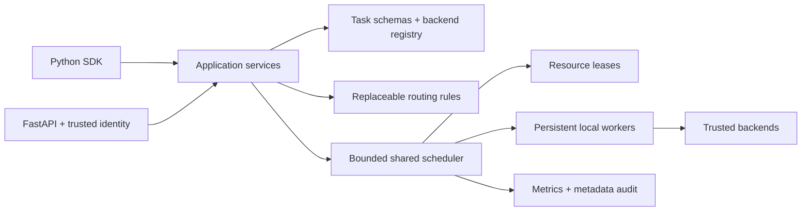
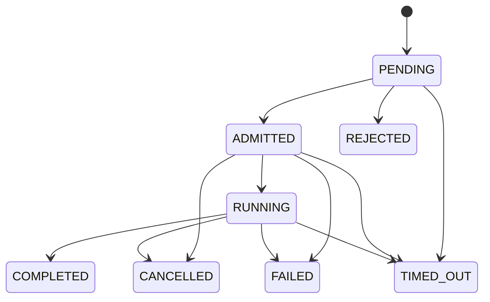

# Architecture

OFlow runs on one host, without a required database, broker, cluster or HTTP hop for SDK calls.

## Six distinct concepts

| Concept | Meaning | Implementation |
|---|---|---|
| Task | Computation and schema | TaskRequest, TaskRegistry, TaskCapability |
| Backend | Registered implementation | BackendDescriptor, lifecycle Protocol; optional batch/cost Protocols |
| Runtime | How code is executed | Bounded persistent thread workers; optional torch/HTTP inside a worker |
| Policy | Selection and scheduling rules | RulesRouter; injectable ExecutionPolicy |
| Profile | Optimization objectives | Configurable batch size, delay, cost budget and priority boost |
| Workflow | Composition of tasks | SDK callers compose tasks; a managed workflow engine is not implemented |

Dependency direction is interfaces → application → contracts/registry/resources/runtime. Core contracts do not import FastAPI, torch or HTTP clients. Pydantic validates public data; YAML is operator configuration. Pure CPU startup does not import optional inference frameworks.

## Scheduling and fairness

One dispatcher owns all admission, state and lease mutations on one asyncio loop. It creates at most the configured number of active requests and at most one physical invocation per available worker slot. Each worker has a bounded ThreadPoolExecutor; the scheduler submits only when that worker has capacity. CPU computation, HTTP calls and GPU inference run in those workers.

Tenants alternate in round-robin order. Within a tenant, request priority plus profile boost is increased by waiting time (aging_seconds). Priorities are bounded, so old work eventually outranks newly arriving high-priority work when capacity is available. Concurrency and queue quotas are independent per tenant. Long nonpreemptible calls can delay all work sharing their worker; fairness cannot preempt kernels or force a hung plugin to return.

Routing first filters task/schema compatibility and tenant permissions. Dispatch considers worker health, runtime initialization, device capacity and memory reservations. Ordered fallback is permitted before execution. Preferred backend is strict. No execution retries or fallback after partial execution are performed.

## State machine

Terminal state and physical completion are separate: a cancelled/timed-out running request keeps its physical slot and lease. Context cancellation is cooperative. Deadline checking occurs while queued and after execution, with a polling interval while running. Cancellation never reuses an in-flight GPU buffer.

## Batching and resources

Backends opt into execute_batch, optionally declaring cheap workload cost estimates. Matching requests from one tenant/task/profile/options can share an invocation. Tenant quotas count requests, not just calls. The generic packer also supports bounded lookahead and padding-efficiency thresholds for adapters that need shape packing. NLP token semantics stay outside the scheduler.

Device inventory records actual resolved CUDA identity where the runtime supplies a UUID; otherwise it records the visible-index mapping. Persistent model-memory leases are held for worker lifetime, and invocation leases account for configured peak memory and device/CPU concurrency. A request-memory budget must cover the entire configured batch. CUDA visibility follows CUDA_VISIBLE_DEVICES; indices are local to that mapping. RAM/VRAM accounting is cooperative and cannot prevent an external process or an underestimated model from exhausting memory.

Worker initialization happens once. A WorkerCrashed/memory-failure signal marks a runtime unhealthy, and bounded restart occurs after it becomes idle. Ordinary request failures are normalized. Restart does not replay failed tasks. Thread workers contain Python exceptions, not segmentation faults or process-wide crashes. WorkerTransport defines the future transport boundary; only local transport is operational.

## Lifecycle and retention

Use async with OFlowEngine(...) on one event loop. execute_sync is a one-shot helper and deliberately creates/closes its own engine. Engine restart after close requires a new instance. Shutdown stops admission, drains for the configured grace interval, signals cancellation, then waits for physical calls before closing backends and leases.

Input payloads are removed from retained job records after physical completion. Terminal records are bounded by count and TTL; rejected submissions are returned directly without accumulating history. API disconnects cancel their execution coroutine and scheduler handle. Result history remains intentionally bounded even if a client never retrieves its result.

SQLite audit is optional, asynchronous and bounded, stores metadata only, and is not durable job execution. No exactly-once or crash-recovery guarantee is made. Application-level delivery is one execution attempt per admitted request; request-ID conflicts are detected only during in-memory retention.
